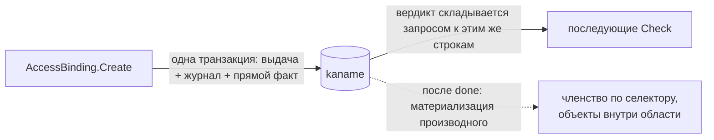

# Модель авторизации

Эта страница объясняет, **как Kaname решает, можно ли действие**. Доступ выражается не списком
правил в коде, а набором *отношений* между субъектами и объектами. Роль и привязка
([Role](/api/role), [AccessBinding](/api/access-binding)) — способ такие отношения *объявить*; в
рантайме проверка — запрос к реляционной форме в собственной базе IAM, разложенный по модели
прав.

## Ключевые понятия

<table>
  <thead><tr><th>Понятие</th><th>Смысл</th></tr></thead>
  <tbody>
    <tr><td><strong>Субъект</strong></td><td>Кто действует: <code>user:usr…</code> / <code>service_account:sva…</code> / <code>group:grp…#member</code></td></tr>
    <tr><td><strong>Объект</strong></td><td>Над чем: <code>account:acc…</code> / <code>project:prj…</code> / <code>vpc_network:enp…</code> / singleton <code>cluster:cluster_root</code></td></tr>
    <tr><td><strong>Отношение</strong></td><td>Связь субъект↔объект: <code>viewer</code> / <code>editor</code> / <code>admin</code> / verb-bearing <code>v_get</code>/<code>v_update</code>/… / <code>owner</code></td></tr>
    <tr><td><strong>Прямой факт</strong></td><td>Записанная тройка <code>(объект, отношение, субъект)</code> в базе IAM</td></tr>
    <tr><td><strong>Scope / tier</strong></td><td>Уровень иерархии привязки: CLUSTER ▶ ACCOUNT ▶ PROJECT</td></tr>
  </tbody>
</table>

## Явная per-object flat-модель

Модель Kaname — **явная и плоская**: доступ к объекту выражается прямыми отношениями на этом
объекте, без неявного каскада вниз по иерархии и без организационного уровня над аккаунтом.
Привязка на PROJECT-scope даёт доступ к ресурсам проекта; привязка на ACCOUNT-scope — к самому
аккаунту и его содержимому через явные отношения, которые IAM записывает. «Иерархия» — это набор
явных отношений, а не рекурсивная функция резолюции.

## Verb-bearing отношения

Центральный механизм — **verb-bearing отношения**. На каждый метод чтения/мутации ресурса
gateway проверяет **точное** отношение, соответствующее глаголу, а не грубое tier-отношение:

<table>
  <thead><tr><th>Метод</th><th>Требуемое отношение</th></tr></thead>
  <tbody>
    <tr><td><code>Get</code></td><td><code>v_get</code></td></tr>
    <tr><td><code>Update</code> / мутирующие <code>:verb</code> (AddMember, ...)</td><td><code>v_update</code></td></tr>
    <tr><td><code>Delete</code></td><td><code>v_delete</code></td></tr>
    <tr><td>per-resource <code>List</code> / <code>ListOperations</code> / <code>ListMembers</code></td><td><code>v_list</code></td></tr>
    <tr><td>Создание дочернего (Project/User/SA/Group/Role в Account)</td><td><code>editor</code> на контейнере</td></tr>
  </tbody>
</table>

`v_*`-отношения **развязаны** с tier-ролями: наличие `editor` на объекте не означает автоматически
`v_get` — verb-bearing грант выдаётся явно правилом роли. Это исключает завышение прав, когда
широкая tier-роль «протекает» в мелкие действия. Роль с правилом `{module: iam, resources:
[projects], verbs: [get, list]}` материализует `v_get`/`v_list` на объектах-проектах в пределах
scope привязки — и ровно их.

```mermaid
flowchart LR
  rpc["RPC Get(project prj7mfpj2my52k5a06kg)"] --> gw["gateway authz-middleware"]
  gw -->|"Check(user:usrbr69ze0ftz3jf7396, v_get, project:prj7mfpj2my52k5a06kg)"| iam["kaname: реляционная форма"]
  iam -->|"allow"| ok["выполнить"]
  iam -->|"deny"| no["403 PERMISSION_DENIED"
```

## List — scope-filter, а не Check

Top-level `List` (Account / Project / User / ServiceAccount / Group / Role) **нельзя** гейтить
одним `Check`: у списка нет единого объекта, а `Check` на `project:*` выдал бы default-deny (403)
всем. Поэтому такие `List` **освобождены** от per-RPC Check на gateway и default-deny реализован
**фильтром страницы в handler'е**: возвращается `200` и только те ресурсы, что видит субъект.
Пустой список, если ничего не видно — **никогда 403**. Handler — авторитетный гейт видимости.

### Предикат страницы = отношение чтения

Строка попадает в страницу `List` **тогда и только тогда, когда вызывающий вправе прочитать этот
объект одиночным `Get`**. Предикат страницы и отношение, которым gateway гейтит `<Service>/Get`, —
одно и то же: **`v_get`**.

Это не сужение выданного доступа, а совпадение двух поверхностей. Ярусные отношения
(`viewer`/`editor`/`admin`) и глагольные (`v_*`) в модели **развязаны** — ни одно не выводится из
другого, — поэтому предикат, собранный из ярусных отношений, и `v_get` описывали бы разные
множества, и список расходился бы с чтением по id в обе стороны. Все три каскадных супер-уровня и
владелец аккаунта резолвят `v_get` структурно (`or super_admin`, у `account` — ещё `or owner`), а
реконсайлер эмитит `v_get` для каждой роли, объявляющей глагол `get`.

<table>
  <thead><tr><th>Тип объекта</th><th>Предикат страницы</th></tr></thead>
  <tbody>
    <tr><td><code>account</code> / <code>project</code> / <code>iam&#95;user</code> / <code>iam&#95;group</code> / <code>iam&#95;service&#95;account</code> / <code>iam&#95;access&#95;binding</code></td><td><code>v&#95;get</code></td></tr>
    <tr><td><code>iam&#95;role</code></td><td><code>viewer</code> ∪ <code>v&#95;list</code> — см. ниже</td></tr>
  </tbody>
</table>

`iam_role` — единственный тип, чьё чтение по id каталог прав не гейтит отношением вовсе
(`<exempt>`): одиночное чтение кастомной роли энфорсится **в сервисе** той же функцией, что
фильтрует страницу. Обе поверхности задают один вопрос и разойтись не могут.

### Стоимость страницы

Видимость резолвится **страницей**, а не перечислением всего, что доступно субъекту, поэтому
стоимость масштабируется размером страницы, а не населением типа. Ошибка резолюции прерывает её
целиком (fail-closed) — частично отфильтрованная страница не отдаётся никогда.

Раньше здесь стоял размен, которого больше нет. Перечисление доступного во внешнем хранилище
отношений имело **жёсткий серверный предел и не имело продолжения**: запрос не нёс поля страницы,
предел был общим на тип, а не по-арендаторным, и объект сверх предела становился владельцу
невидим **навсегда при живых правах**. Реляционная форма перечисляет курсором по собственной
таблице, поэтому предела нет by construction, а `nextPageToken` наконец означает то, что обещает
контракт.

:::warning Освобождение снимает authz, но не authN — и обязано называть причину
`<exempt>`-RPC (List'ы, `Role.Get`, `WhoAmI`, `Account.Create`, `AccessBinding.Create`)
не проходят per-RPC Check, но **анонима всё равно отвергает** anti-anonymous
интерсептор IAM (`UNAUTHENTICATED`). Освобождается только *авторизация*.

Каждая такая запись каталога несёт **причину** из закрытого словаря —
`INTERNAL_LISTENER` · `SERVICE_SIDE_AUTHZ` · `SELF_SERVICE` · `HANDLER_DECIDES`:
один и тот же литерал стоял за четырьмя несопоставимыми полосами, и отличить их
можно было только прочитав реализацию каждого RPC.

Причины «глобальный справочник» в словаре **нет**. Публичное чтение справочника
(регионы, зоны, типы машин, типы дисков, словарь прав) освобождением больше не
выражается: оно стоит на отношении, которое платформа выдаёт **системной выдачей**
субъекту «любой аутентифицированный», — и потому видно перечислением выдач и
отзывается штатно.
:::

## Owner и cluster-admin

- **Owner** аккаунта (`ownerUserId`) получает полный доступ к содержимому аккаунта через
  cluster-role owner-механику; при создании аккаунта заводится защищённая owner-привязка
  (`deletionProtection=true`).
- **cluster-admin** (`systemAdmin` на singleton `cluster:cluster_root`) — short-circuit:
  проходит любой per-resource Check. Это платформенный администратор.
- **grant-authority** — право *выдавать* доступ (`AccessBinding.Create`): владелец
  аккаунта-владельца scope ИЛИ FGA `admin` на объекте scope. Проверяется в handler'е, т.к. тип
  объекта scope зависит от запроса.

## Step-up (ACR floor) {#step-up}

`required_acr_min=2` — **минимальный уровень уверенности аутентификации**: если ACR
токена ниже требуемого, запрос не исполняется независимо от наличия отношения. Уровень `2` дают
три источника — вход ключом доступа (всякое утверждение ключа, не дающее `3`, в том числе
синхронизируемого), пароль с кодом по времени и пароль с запасным кодом; уровень `3` — только ключ доступа, выполнивший
проверку пользователя и не допускающий резервного копирования; один пароль — `1`
([полоса входа](/api/auth-lane#access-key-login)). Поэтому способ, чьё предъявление одно даёт
`2` (ключ доступа), заводится и снимается только сессией `2`, а код второго фактора у человека с
ключом заводится тоже сессией `2` ([второй фактор](/api/auth-lane#second-factor)). Так же и
адрес почты у человека с кодом по времени либо ключом доступа меняется только сессией `2` — и
запрос смены, и предъявление кода ([смена адреса](/api/auth-lane#email-change)). Заведённое у
человека эти условия читают внутри своей транзакции записи, под замком, с которым несовместимо
заведение способа: способ, заведённый одновременно с глаголом, глагол не пропускает.
Свежесть предъявления этот порог не проверяет: он судит уровень сессии, а не давность входа.
Окно свежести у заведения и снятия ключа доступа и у заведения второго фактора — **отдельная**
проверка самого действия, с собственным отказом «предъявите удостоверение снова»; порог её не
заменяет, и она не заменяет порога. Ответ — **указание
повысить уровень**, а не отказ прав: `401` / `16`, текст, называющий шаг, и вызов
`insufficient_user_authentication` с `acr_values` — одной формой на краю и на REST-фронте и
gRPC службы ([форма указания](/api/rest-surface#step-up)).
Запрос, где субъект — служебная учётка, от порога освобожден: он судится только отношением, и
без отношения служебная учётка получает отказ прав, а не указание повысить уровень. Поэтому
выдачу и отзыв удостоверений базовый токен служебной учётки с нужным отношением исполняет, а
базовый токен человека (уровень `1` ниже порога `2`) — нет
([переход на базовый токен](/api/tokens#transition)).

Floor стоит на **узком наборе** RPC, а не на пользовательской поверхности целиком. Критерий —
**операция меняет posture безопасности**. Перечень ниже **выведен из контракта** — из опции
`required_acr_min = "2"` у RPC в `proto/kaname/cloud/iam/v1/*.proto` — и сверяется с ним
пробой в обе стороны: глагол с порогом, которого здесь нет, и глагол здесь, у которого порога
нет, — обе находки.

<table>
  <thead><tr><th>Что меняется</th><th>Глаголы</th></tr></thead>
  <tbody>
    <tr><td>выдача и отзыв удостоверений</td><td><code>UserTokenService.Issue</code>, <code>UserTokenService.Revoke</code>, <code>SAKeyService.Issue</code>, <code>SAKeyService.Revoke</code></td></tr>
    <tr><td>заведение и снятие способа, дающего «2»</td><td><code>AccessKeyService.BeginRegistration</code>, <code>AccessKeyService.FinishRegistration</code>, <code>AccessKeyService.Revoke</code></td></tr>
    <tr><td>выдача и отзыв прав</td><td><code>AccessBindingService.Create</code>, <code>AccessBindingService.Update</code>, <code>AccessBindingService.Delete</code>, <code>AccessBindingService.Revoke</code>, <code>GrantDelegationService.Create</code>, <code>GrantDelegationService.Revoke</code>, <code>RoleService.Update</code>, <code>GroupService.AddMember</code>, <code>GroupService.RemoveMember</code>, <code>InternalClusterService.GrantAdmin</code>, <code>InternalClusterService.RevokeAdmin</code>, <code>ClusterService.GrantAdmin</code>, <code>ClusterService.RevokeAdmin</code></td></tr>
    <tr><td>состав арендатора и его личностей</td><td><code>UserService.Invite</code>, <code>UserService.ResendInvite</code>, <code>MembershipService.Create</code>, <code>UserService.RemoveFromAccount</code>, <code>UserService.Block</code>, <code>UserService.Unblock</code>, <code>UserService.ResetSecondFactor</code>, <code>UserService.ResetAccessKeys</code>, <code>ServiceAccountService.Enable</code>, <code>ServiceAccountService.Disable</code></td></tr>
    <tr><td>регистрация интерактивного клиента</td><td><code>InternalInteractiveClientService.Create</code>, <code>InternalInteractiveClientService.Update</code>, <code>InternalInteractiveClientService.Delete</code></td></tr>
    <tr><td>применение модели доступов модуля</td><td><code>InternalModuleService.Apply</code></td></tr>
    <tr><td>необратимое удаление</td><td><code>AccountService.Delete</code>, <code>ProjectService.Delete</code>, <code>GroupService.Delete</code>, <code>RoleService.Delete</code>, <code>UserService.Delete</code>, <code>ServiceAccountService.Delete</code></td></tr>
  </tbody>
</table>

Приглашение и повторная отправка письма стоят в перечне по той же причине, что и
`AccessBindingService.Create`: `projectId` + `roleId` заводят привязку атомарно с членством, и
порог ниже порога привязки был бы обходом step-up через более дешёвую дверь; сброс второго
фактора и сброс ключей доступа — надзор облака над способами входа человека. Регистрация и
снятие ключа доступа стоят не ниже выпуска личного токена: ключ открывает этот выпуск, и
заведение способа дешевле открываемого им действия было бы той же дешёвой дверью; пол стоит на
обоих глаголах церемонии, потому что испытание привязано к человеку, а не к сессии. Потерявший
единственный способ «2» при живом пароле возвращает его через надзор облака
(`UserService.ResetAccessKeys`), после чего заводит второй фактор свежей сессией «1».

Рутинные чтения и обычный CRUD ресурсов floor **не несут**: сплошной step-up превратил бы
повторную аутентификацию в фоновый шум, на который перестают смотреть, и ничего бы не защитил.

:::note Здесь стояли числа — и они устарели молча; потом стоял выписанный перечень — и он тоже
Прежняя редакция называла «из 289 записей каталога прав его несут 24, из них 22 — в IAM».
Числа были выписаны, а не выведены, поэтому расходились с каталогом при каждой новой записи.
Следующая редакция заменила числа перечнем — выписанным, и он разошёлся тем же способом: к
2026-09-17 в нём не было `MembershipService.Create`, `UserService.ResendInvite`,
`UserService.ResetSecondFactor` и `InternalModuleService.Apply` при живом пороге у всех
четырёх.

Заметить это чтением нельзя: перечень выглядит полным. Поэтому теперь перечень **держит проба**
(`internal/check`, страница сверяется с контрактом), а точные величины на любой ревизии — из
самого контракта, одной командой:

```bash
# глаголов с порогом 2 в контракте службы
git grep -c 'required_acr_min) = "2"' -- 'proto/kaname/cloud/iam/v1/*.proto'
# их перечень
git grep -B40 'required_acr_min) = "2"' -- 'proto/kaname/cloud/iam/v1/*.proto' | grep -oE '(service [A-Za-z]+|rpc [A-Za-z]+)'
```

Каталог прав края собирается из тех же опций и сверяется с копией службы гейтом сборки
(`make check-permission-catalog`): число, взятое из контракта, и есть факт.
:::

## Условия на кортежах

Условие — предикат, который обязан быть истинным, чтобы отношение считалось действующим. Условия
объявлены в модели прав и вычисляются при проверке по доводам, которые служба выводит сама (ниже):

<table>
  <thead><tr><th>Условие</th><th>Семантика</th></tr></thead>
  <tbody>
    <tr><td><code>mfa&#95;fresh</code></td><td>acr=3 — ключ доступа, выполнивший проверку пользователя и не допускающий резервного копирования (синхронизируемый ключ даёт <code>2</code> и условию не удовлетворяет) — + <code>webauthn</code> в amr + предъявление ключа в пределах окна, объявленного в самом условии модели</td></tr>
    <tr><td><code>non&#95;expired</code></td><td><code>now() &lt; valid&#95;until</code></td></tr>
    <tr><td><code>source&#95;ip&#95;in&#95;range</code></td><td>Source IP входит в один из настроенных CIDR</td></tr>
    <tr><td><code>jit&#95;window</code></td><td>Разрешено в течение <code>ttl&#95;seconds</code> после активации</td></tr>
    <tr><td><code>business&#95;hours</code></td><td>Пн–Пт в интервале <code>[start&#95;h, end&#95;h)</code> в настроенном TZ</td></tr>
    <tr><td><code>device&#95;compliant</code></td><td>Согласие устройства: атрибут контекста, который сервер принимает только от себя (присланное вызывающим удаляется); производителя у него сегодня нет, и ни на одно отношение условие не навешено. О ключах доступа условие не судит: продукт их модель не проверяет и не хранит</td></tr>
  </tbody>
</table>

**Условие задаёт сервер, а не тенант.** Оно навешивается там, где его объявляет сама модель: тип
`compute_instance` принимает человека в отношения `ssh` и `console` только `with mfa_fresh`
(служебную учётку на `ssh` — без условия). Ключ условия выбирает платформа при написании модели;
в запросе на выдачу прав условие не передаётся. Прямой факт складывает триггер журнала, и он же
прикладывает к факту человека на этих отношениях условие модели — факта человека на них без
условия не бывает.

**Доводы `mfa_fresh` приходят не из тела вопроса.** Тело вопроса о правах — вход вызывающего,
поэтому служба вырезает из него всё, что описывает аутентификацию (`acr_value`, `amr_claims`,
`mfa_at` и другие), и подставляет только то, чему доверяет сама: уровень уверенности — пересланный
краем, а способы и момент — из **своей записи сессии вопроса**. Запись находится по номеру, который
край узнал из ответа службы о сессии и переслал с вопросом доверенным ключом; годна она, только
если жива на момент вопроса и принадлежит той же личности, от имени которой задан вопрос. Способы —
множество предъявленного в этой сессии, момент — момент её аутентификации (повторное предъявление
внутри сессии его не двигает). У вопроса без нашей сессии — токеном доступа, базовым
удостоверением, от машинной учётки — доводов способов и момента нет, и условие ложно.

**Что снимает отказ по `mfa_fresh`.** Условию нужны уровень `3`, `webauthn` среди способов и
момент аутентификации сессии в пределах окна. Повышение внутри сессии способы и уровень
добавляет, но момента аутентификации не двигает, поэтому отказа по условию оно не снимает, сколько
его ни повторяй. Снимает его **новый вход** ключом доступа, выполнившим проверку пользователя и не
допускающим резервного копирования ([вход ключом доступа](/api/auth-lane#access-key-login)):
новая сессия получает `3`, `webauthn` и свежий момент аутентификации.

:::warning Привязка условия не несёт
`AccessBinding` **не имеет** полей условия. Теги `9`/`14` и имена `condition_id` /
`builtin_condition` в контракте зарезервированы (`reserved`), тенантского ресурса условия и его
REST-поверхности не существует. Ни один путь принятия решения эти поля не читал, поэтому они сняты
с контракта целиком, а не оставлены «на будущее»: поле, которое принимают и не читают, обещает
возможность, за которую никто не отвечает. Будущий дизайн условий на выдаче начнётся с чистого
номера поля.
:::

## Где хранится право и когда оно начинает действовать

Роли и привязки лежат в Postgres IAM — и **решение о доступе вычисляется там же**. Мутация
привязки в одной транзакции пишет строку выдачи, строку журнала намерений и прямой факт,
складываемый из неё триггером журнала. Отдельного хранилища отношений, до которого право должно
«доехать», не существует.

Владение ресурсами других сервисов (VPC / Compute / NLB) регистрируется через
`InternalIAMService.RegisterResource` — модули пишут отношение не сами, а через IAM.



:::tip С момента фиксации действует прямой факт, производное — после `done`
`Operation.done=true` означает **сохранность привязки**: прямой факт выдачи зафиксирован той же
транзакцией и виден следующему `Check`. Производное — членство субъектов, подобранных селектором,
и доступ к объектам внутри области привязки — служба материализует **после** `done`, отдельным
проходом; величина окна зависит от объёма области и числом не обещается.

Отказ, полученный в этом окне, не запоминается: служба хранит только положительный вердикт, а
край платформы `deny` не кеширует. Поэтому первый вызов сразу после выдачи делайте с
ограниченным повтором на `PERMISSION_DENIED`. Ребра из службы к краю нет: свой кэш решений край
гасит сам, читая журнал смены субъекта, — это путь **отзыва**, а не выдачи.
:::

:::note Здесь была задержка распространения — её больше нет
Прежняя редакция обещала «~0.6–2 c пропагации», пока право доезжало до внешнего хранилища
отношений очередью. Ни хранилища, ни очереди к нему не существует, и для прямого факта
состояние «привязка создана, но право ещё не действует» **невыразимо by construction**; окно
остаётся только у производного, материализуемого после `done`. Цена размена названа прямо:
недоступность базы IAM теперь означает отказ в доступе целиком — раньше это выглядело как две
независимые поломки, но и тогда было одной (каскад супер-доступа читался из тех же строк).
:::

## Fail-closed

Недоступность базы IAM на пути запроса → отказ (`UNAVAILABLE`), не «разрешить по умолчанию». Internal-периметр (`:9091`) mTLS-обязателен и всё равно гейтит каждый RPC. Анонимный
запрос отвергается везде. Модель — **secure-by-default**; см. также
[Особенности дизайна](/advanced/design-decisions).
